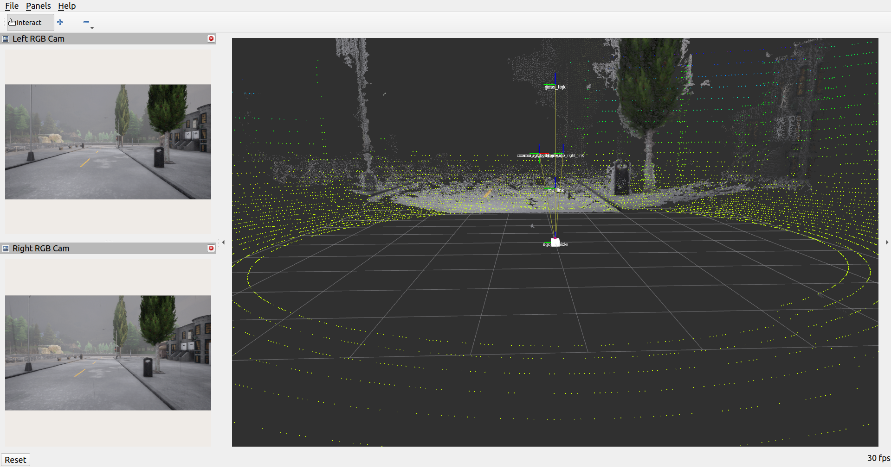

# ADS Development Pipeline for CARLA

ROS 2 Python nodes for spawning an ego vehicle and sensor suite in CARLA, publishing the sensor data as ROS topics, and generating a colored 3D point cloud from a synchronized stereo RGB camera pair.

## Stereo point cloud

The stereo node subscribes to the left and right RGB image topics, pairs messages with an approximate-time synchronizer (20 ms tolerance), computes disparity, and publishes the resulting colored point cloud. Depth is estimated using the pinhole stereo relation $Z = fB/d$, where $f$ is focal length in pixels, $B$ is the camera baseline, and $d$ is disparity in pixels. Points beyond 50 m and invalid disparities are discarded.

The current node uses a 0.5 m baseline and derives the focal length and principal point from the camera width and horizontal field of view in its ROS parameters. Keep these values consistent with the stereo camera setup. The cameras should be horizontally aligned and have matching image dimensions and field of view for the unrectified SGBM calculation to work well.

| Data | ROS topic | Message |
| --- | --- | --- |
| Left RGB image | `/carla/camera/rgb/left/image` | `sensor_msgs/Image` |
| Right RGB image | `/carla/camera/rgb/right/image` | `sensor_msgs/Image` |
| Stereo point cloud | `/carla/stereo/points` | `sensor_msgs/PointCloud2` |
| LiDAR point cloud | `/carla/lidar/points` | `sensor_msgs/PointCloud2` |
| GNSS fix | `/carla/gnss/fix` | `sensor_msgs/NavSatFix` |
| IMU data | `/carla/imu/data` | `sensor_msgs/Imu` |

## Requirements

- ROS 2 with `colcon`, `rosdep`, and the Python packages declared by the ROS package.
- CARLA Simulator, with its Python API available to the selected ROS 2 Python environment.
- The `l2_carla_demo` package providing CARLA-to-ROS message conversions.
- OpenCV, NumPy, and `message_filters` for stereo processing.

The CARLA server and ROS 2 client must use compatible CARLA versions. Start the CARLA server before launching this package.
## Prerequisites & Installation

This package sits side-by-side with its dependencies in a standard ROS workspace. 

```bash
# Navigate to your workspace source directory
cd ~/carla_ws/src

# Clone the required conversion library dependency (Dr. Zeid Kootbally
git clone https://github.com/rubixcubic/enpm818z-fall-2026-carla-ros

# Clone this repository
```

From the ROS 2 workspace root:

```bash
cd ~/carla_ws
rosdep install --from-paths src --ignore-src -r -y
colcon build --symlink-install --packages-up-to ads_development
source install/setup.bash
```

Source `~/carla_ws/install/setup.bash` in every new terminal before using the package.

## Run

### 1. Start CARLA

In a terminal at the CARLA installation directory, launch the server and wait until it is ready:

```bash
./CarlaUE4.sh -quality-level=Low -nosound -vulkan -RenderOffScreen
```

### 2. Start the sensor manager

In a new terminal:

```bash
cd ~/carla_ws
source install/setup.bash
ros2 launch ads_development sensors_launch.py
```

Autopilot is enabled by default in the launch file. To explicitly disable it, pass `autopilot:=false`. To use a different sensor YAML configuration, pass `config:=/absolute/path/to/config.yaml`.

### 3. Start stereo processing

In another sourced terminal:

```bash
cd ~/carla_ws
source install/setup.bash
ros2 run ads_development stereo_camera
```

The stereo node must be running in addition to the sensor manager to publish `/carla/stereo/points`.

### 4. Open RViz2

In another sourced terminal:

```bash
cd ~/carla_ws
source install/setup.bash
rviz2 -d "$(ros2 pkg prefix ads_development)/share/ads_development/rviz/ads_development.rviz"
```

The configured fixed frame is `ego_vehicle`. If the point cloud is not visible, confirm the CARLA server, sensor manager, and stereo node are all running, and that RViz2 is subscribed to `/carla/stereo/points`.




## Roadmap

- [x] Stereo camera vision and 3D visualisation.
- [ ] Port core logic to `C++`
- [ ] Benchmark against standard LiDAR ground truth
- [ ] EKF measurement
- [ ] Object detection with YOLO/DETR 3D detection boxes
- [ ] Tracking by EKF
- [ ] Downstream motion planning algorithms


## Credits & Acknowledgments

A special thanks to **Dr. Zeid Kootbally** for providing the foundations & starter code for this project. 

This repository relies on his public [CARLA-ROS starter](https://github.com/rubixcubic/enpm818z-fall-2026-carla-ros) `l2_carla_Demo` package as an abstraction layer to convert datt between the **CARLA Simulator** and **ROS** and is licensed under Apache 2.0. 


## License

This project is licensed under the Apache License - see the [LICENSE](LICENSE) file for details.
